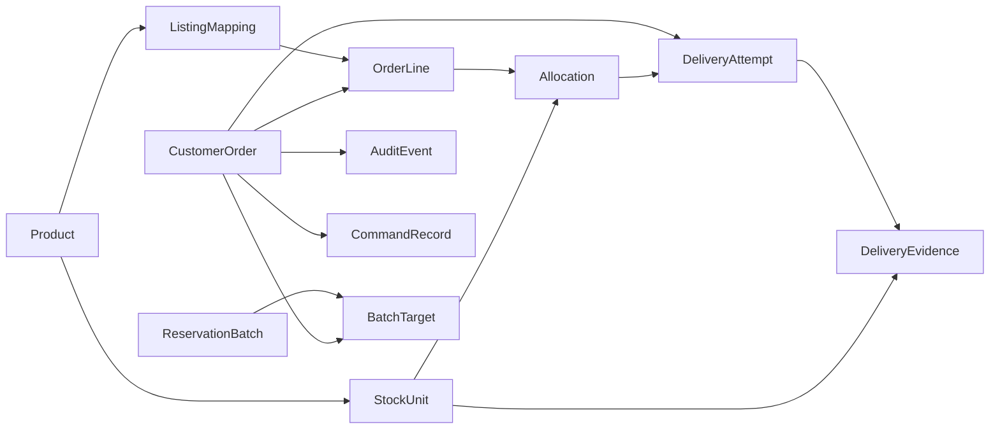

## Domain model

Zeta's persistent data model consists of entities for synthetic products, encrypted inventory, marketplace orders, fulfillment decisions, delivery effects, evidence, auditing, idempotency, and durable batch operations. This page documents the entities, enumerations, and relationships that connect those records.

The model is defined primarily in [`src/Zeta.Core/Model.cs`](../src/Zeta.Core/Model.cs), with persistence constraints configured in [`src/Zeta.Infrastructure/CommerceDb.cs`](../src/Zeta.Infrastructure/CommerceDb.cs).

## Constants and synthetic scope

All persisted records belong to the synthetic demonstration scope unless a field explicitly records another entity relationship.

<ParamField body="Business" param-type="string" show-location="false">`demo-business`</ParamField>

<ParamField body="Shop" param-type="string" show-location="false">`DEMO-SHOP`</ParamField>

<ParamField body="Environment" param-type="string" show-location="false">`synthetic`</ParamField>

<ParamField body="Channel" param-type="string" show-location="false">`synthetic-manual`</ParamField>

<ParamField body="Schema version" param-type="integer" show-location="false">`2`</ParamField>

Zeta enforces the synthetic boundary across products, identifiers, recipients, imported codes, orders, and fixture evidence. The model does not represent live marketplace or delivery data.

## Enumerations

### StockState

`StockState` records the lifecycle state of an individual inventory unit.

- `AVAILABLE`: Eligible for reservation.
- `RESERVED`: Assigned to an order but not yet delivered.
- `QUARANTINED`: Removed from normal availability pending review or because exposure makes reuse unsafe.
- `DELIVERED`: Confirmed as delivered or covered by accepted seller evidence.
- `INVALID`: Not eligible for reservation, including expired units.

### OrderState

`OrderState` records Zeta's internal processing state for an order.

- `PENDING`: Order is available for eligibility checks and reservation.
- `BLOCKED`: A visible hold prevents normal processing.
- `RESERVED`: All required inventory units are allocated.
- `QUEUED`: The order is approved for simulated delivery.
- `DELIVERING`: A durable delivery attempt has started.
- `FAILED`: A definite delivery rejection occurred without exposure.
- `REVIEW_REQUIRED`: The delivery result or inventory state requires manual investigation.
- `FULFILLED`: All assigned units have accepted delivery evidence.
- `CANCELLED`: The order was cancelled before exposure and its safe allocations were released.
- `CLOSED_EXTERNAL`: The order was reviewed as handled externally before any allocation existed.
- `CLOSED_EXCEPTION`: A reviewed exception was explicitly closed.

### Outcome

`Outcome` records the result returned by the synthetic delivery adapter.

- `Confirmed`
- `Rejected`
- `Pending`
- `Partial`
- `Unknown`
- `CrashAfterEffect`

`Pending`, `Unknown`, `Partial`, and `CrashAfterEffect` represent outcomes that cannot be treated as a definite rejection. Recovery retains the possible effect and moves the order toward review.

### EvidenceKind

`EvidenceKind` identifies the source represented by a delivery evidence record.

- `SIMULATED_CHANNEL_ACCEPTED`: Synthetic channel evidence for a confirmed delivery result.
- `SIMULATED_SELLER_ATTESTED`: Manual seller attestation for exposed or delivered units.

## Entities

### Product

A `Product` represents a synthetic inventory product and provides the parent record for its stock units and exact listing mappings.

<ParamField body="Id" param-type="string" show-location="false">Unique product identifier.</ParamField>

<ParamField body="BusinessId" param-type="string" show-location="false">Business scope containing the product. Synthetic products use `demo-business`.</ParamField>

<ParamField body="Name" param-type="string" show-location="false">Display name for the product.</ParamField>

<ParamField body="Threshold" param-type="integer" show-location="false">Low-stock threshold. Zeta reports low stock when available quantity is less than or equal to this value.</ParamField>

<ParamField body="Version" param-type="integer" show-location="false">Optimistic concurrency version for the product.</ParamField>

<ProductLimit />

<ProductLimit />

<Callout kind="alert">

The prototype caps the product catalog at 200 products.

</Callout>

### ListingMapping

A `ListingMapping` connects one exact marketplace item and model identity to a `Product`. Zeta captures the mapping version when it creates an allocation so later mapping changes cannot silently alter an existing reservation.

<ParamField body="Marketplace" param-type="string" show-location="false">Marketplace identifier for the listing.</ParamField>

<ParamField body="Environment" param-type="string" show-location="false">Environment containing the listing, such as `synthetic`.</ParamField>

<ParamField body="Shop ID" param-type="string" show-location="false">Shop containing the listing.</ParamField>

<ParamField body="Item ID" param-type="string" show-location="false">Marketplace item identifier.</ParamField>

<ParamField body="Model ID" param-type="string" show-location="false">Marketplace model or variation identifier.</ParamField>

<ParamField body="Product ID" param-type="string" show-location="false">Product assigned to the exact listing identity.</ParamField>

<ParamField body="Mapping version" param-type="integer" show-location="false">Version used to detect mapping changes after reservation.</ParamField>

<Callout kind="alert">

Mappings use exact `Marketplace`, `Environment`, `Shop ID`, `Item ID`, and `Model ID` matching. Zeta does not perform name, SKU, or fuzzy matching.

</Callout>

### StockUnit

A `StockUnit` represents one encrypted digital inventory code. The unit remains identifiable for allocation, expiry, state transitions, and evidence without storing its plaintext value.

<ParamField body="Product association" param-type="relationship" show-location="false">Reference to the product that owns the inventory unit.</ParamField>

<ParamField body="AES-GCM ciphertext" param-type="string" show-location="false">Encrypted representation of the synthetic code.</ParamField>

<ParamField body="HMAC fingerprint" param-type="string" show-location="false">Keyed fingerprint used for duplicate detection without decrypting the code.</ParamField>

<ParamField body="Import ID" param-type="string" show-location="false">Identifier for the import operation that created the unit.</ParamField>

<ParamField body="Import timestamp" param-type="timestamp" show-location="false">Time at which the unit was imported.</ParamField>

<ParamField body="Optional expiration" param-type="timestamp" required="false" show-location="false">Optional expiration time. Expired available units become `INVALID`.</ParamField>

<ParamField body="Stock state" param-type="StockState" show-location="false">Current inventory lifecycle state.</ParamField>

<ParamField body="Exposure flag" param-type="boolean" show-location="false">Indicates whether the code was exposed during reveal or an uncertain effect.</ParamField>

<ParamField body="Version" param-type="integer" show-location="false">Optimistic concurrency version for the unit.</ParamField>

<Callout kind="info">

The plaintext code is not stored in the database. Zeta stores AES-GCM ciphertext and a separate HMAC fingerprint for encryption and duplicate detection.

</Callout>

### CustomerOrder

A `CustomerOrder` represents a synthetic marketplace order observed by Zeta. It stores both the source observation and the internal state used by reservation, approval, delivery, cancellation, and recovery workflows.

<ParamField body="Order ID" param-type="string" show-location="false">Synthetic marketplace order identifier.</ParamField>

<ParamField body="Business/shop/environment scope" param-type="scope" show-location="false">Business, shop, and environment identifiers that establish the order's synthetic scope.</ParamField>

<ParamField body="Raw source status" param-type="string" show-location="false">Status reported by the synthetic marketplace source, such as `READY_TO_SHIP`.</ParamField>

<ParamField body="Paid flag" param-type="boolean" show-location="false">Indicates whether the source reports the order as paid.</ParamField>

<ParamField body="Supported flag" param-type="boolean" show-location="false">Indicates whether Zeta supports processing the observed order.</ParamField>

<ParamField body="Synthetic recipient" param-type="string" show-location="false">Recipient used by the synthetic delivery boundary.</ParamField>

<ParamField body="Source observation time" param-type="timestamp" show-location="false">Time at which Zeta observed the source order.</ParamField>

<ParamField body="Source observation version" param-type="string" show-location="false">Source version captured with the order observation.</ParamField>

<ParamField body="Internal processing state" param-type="OrderState" show-location="false">Zeta's current order state.</ParamField>

<ParamField body="Hold reason" param-type="string" required="false" show-location="false">Reason the order is blocked or requires review.</ParamField>

<ParamField body="Version" param-type="integer" show-location="false">Optimistic concurrency version for the order.</ParamField>

<ParamField body="OrderLine collection" param-type="collection" show-location="false">Line items that specify the exact marketplace item, model, and quantity required by the order.</ParamField>

An order must pass source freshness, payment, support, recipient, mapping, and line-stability checks before reservation or delivery approval.

### OrderLine

An `OrderLine` describes the quantity of one exact marketplace item and model required by a `CustomerOrder`.

<ParamField body="Order ID" param-type="string" show-location="false">Order containing the line.</ParamField>

<ParamField body="Item ID" param-type="string" show-location="false">Marketplace item identifier used for exact mapping.</ParamField>

<ParamField body="Model ID" param-type="string" show-location="false">Marketplace model identifier used for exact mapping.</ParamField>

<ParamField body="Quantity" param-type="integer" show-location="false">Positive number of units required for the line.</ParamField>

### Allocation

An `Allocation` assigns a specific `StockUnit` to an `OrderLine`. Reservation creates allocations only after it has resolved every line and confirmed sufficient inventory for the entire order.

<ParamField body="Order" param-type="relationship" show-location="false">Order receiving the assigned stock unit.</ParamField>

<ParamField body="Line" param-type="relationship" show-location="false">Order line that requires the assigned unit.</ParamField>

<ParamField body="Unit" param-type="relationship" show-location="false">Stock unit assigned to the line.</ParamField>

<ParamField body="Mapping" param-type="relationship" show-location="false">Exact listing mapping used to resolve the line.</ParamField>

<ParamField body="Mapping version used" param-type="integer" show-location="false">Mapping version captured when the allocation was created.</ParamField>

<ParamField body="Ordinal" param-type="integer" show-location="false">Position of the allocation within its order line.</ParamField>

<ParamField body="Active flag" param-type="boolean" show-location="false">Indicates whether the allocation currently participates in the order's assignment.</ParamField>

Active allocations and line ordinals are protected by unique filtered indexes. This prevents one stock unit from being actively assigned more than once and prevents duplicate allocation positions within a line.

### DeliveryAttempt

A `DeliveryAttempt` is the durable marker for a simulated delivery effect. Zeta commits the marker before invoking the synthetic delivery provider so restart recovery can distinguish an effect that may have started from one that never began.

<ParamField body="Order" param-type="relationship" show-location="false">Order associated with the delivery attempt.</ParamField>

<ParamField body="Delivery ID" param-type="string" show-location="false">Identifier for the synthetic delivery operation.</ParamField>

<ParamField body="Recipient" param-type="string" show-location="false">Synthetic recipient targeted by the attempt.</ParamField>

<ParamField body="Allocation fingerprint" param-type="string" show-location="false">Fingerprint of the assigned allocation set used to bind the attempt to a specific reservation.</ParamField>

<ParamField body="Start timestamp" param-type="timestamp" show-location="false">Time at which the attempt marker was created.</ParamField>

<ParamField body="End timestamp" param-type="timestamp" required="false" show-location="false">Time at which the attempt reached a recorded end state.</ParamField>

<ParamField body="Result" param-type="Outcome" required="false" show-location="false">Synthetic provider result, when committed.</ParamField>

<ParamField body="Reveal flag" param-type="boolean" show-location="false">Indicates whether the assigned codes were revealed during the attempt or its handling.</ParamField>

Only one unfinished delivery attempt may exist for an order. Interrupted attempts are treated conservatively and move the order toward `REVIEW_REQUIRED` rather than triggering an automatic resend.

### DeliveryEvidence

A `DeliveryEvidence` record links an assigned unit to evidence that supports delivery or seller attestation.

<ParamField body="Order" param-type="relationship" show-location="false">Order for which the evidence applies.</ParamField>

<ParamField body="Unit" param-type="relationship" show-location="false">Assigned stock unit covered by the evidence.</ParamField>

<ParamField body="Attempt" param-type="relationship" show-location="false">Delivery attempt associated with the evidence.</ParamField>

<ParamField body="Evidence kind" param-type="EvidenceKind" show-location="false">Source classification of the evidence.</ParamField>

<ParamField body="Reference" param-type="string" show-location="false">Synthetic reference supplied by the channel or seller attestation.</ParamField>

<ParamField body="Actor" param-type="string" show-location="false">Actor associated with the evidence record.</ParamField>

<ParamField body="Timestamp" param-type="timestamp" show-location="false">Time at which the evidence was recorded.</ParamField>

Each order and unit pair has unique evidence. Seller attestation must cover assigned units and uses a `DEMO-` reference.

### AuditEvent

An `AuditEvent` is an append-only record of a business action or state-changing operation.

<ParamField body="Business ID" param-type="string" show-location="false">Business scope of the audited action.</ParamField>

<ParamField body="Entity ID" param-type="string" show-location="false">Identifier of the entity affected by the action.</ParamField>

<ParamField body="Action" param-type="string" show-location="false">Action name recorded in the audit history.</ParamField>

<ParamField body="Facts" param-type="structured data" show-location="false">Redacted or structured facts associated with the action.</ParamField>

<ParamField body="Actor" param-type="string" show-location="false">Actor that initiated or performed the action.</ParamField>

<ParamField body="Correlation ID" param-type="string" show-location="false">Identifier used to correlate related operations.</ParamField>

<ParamField body="Timestamp" param-type="timestamp" show-location="false">Time at which the action was recorded.</ParamField>

Database triggers protect audit history from unsafe updates and deletes.

### CommandRecord

A `CommandRecord` provides durable idempotency for mutating commands.

<ParamField body="Command key" param-type="string" show-location="false">Client-supplied key identifying the command invocation.</ParamField>

<ParamField body="Payload fingerprint" param-type="string" show-location="false">Fingerprint of the command payload used to detect conflicting reuse of a key.</ParamField>

<ParamField body="Serialized command result" param-type="string" show-location="false">Serialized result returned when the command first committed.</ParamField>

Replaying a command with the same key and payload returns the stored result. Reusing the key with a different payload produces an idempotency conflict.

### ReservationBatch

A `ReservationBatch` represents a durable explicit batch reservation operation.

<ParamField body="Batch ID" param-type="string" show-location="false">Identifier for the reservation batch.</ParamField>

<ParamField body="Creation time" param-type="timestamp" show-location="false">Time at which the batch was created.</ParamField>

<ParamField body="BatchTarget collection" param-type="collection" show-location="false">Per-order targets that store expected versions and individual results.</ParamField>

A batch freezes the selected order IDs and expected versions. It reserves each target independently, stores each result, survives restart, and does not perform approval or delivery.

### BatchTarget

A `BatchTarget` stores the per-order state of a `ReservationBatch`.

<ParamField body="Batch" param-type="relationship" show-location="false">Reservation batch containing the target.</ParamField>

<ParamField body="Order" param-type="relationship" show-location="false">Order selected for reservation processing.</ParamField>

<ParamField body="Expected version" param-type="integer" show-location="false">Order version expected when the target is processed.</ParamField>

<ParamField body="Result state" param-type="string" show-location="false">Result recorded for this target, including success or a processing failure.</ParamField>

The batch target prevents a restarted batch from repeating targets that have already committed and allows each order to report an independent result.

## Entity relationships

The core fulfillment relationship flows from a product listing to an order, then from the order to encrypted inventory and delivery evidence.

A `CustomerOrder` contains one or more `OrderLine` records. Each line resolves through an exact `ListingMapping`, and reservation creates `Allocation` records that pair the line with individual `StockUnit` records. A `DeliveryAttempt` records the possible external effect, while `DeliveryEvidence` records the unit-level support required for fulfillment.