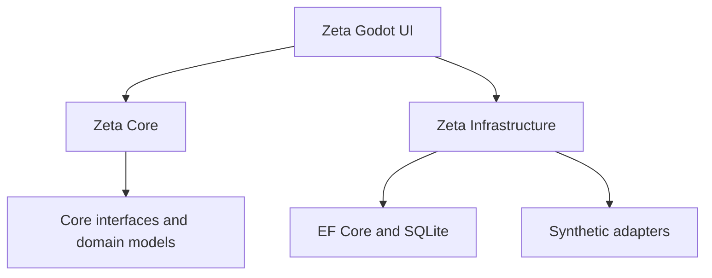

## Layered architecture

After reading this page, you will understand the architectural patterns and design decisions that shape Zeta's behavior, including how commands, persistence, external effects, recovery, and UI updates interact.

Zeta separates the Godot interface, application and domain logic, and infrastructure concerns into three layers:



### Zeta.Core

`Zeta.Core` is the pure C# domain and application layer. It has no Godot, Entity Framework Core, or SQL dependencies, so business rules remain independent from the user interface and storage technology.

The layer contains:

- `Model.cs`: Entities, enums, records, DTOs, and domain exceptions.
- `Ports.cs`: Storage, encryption, marketplace, and delivery interfaces.
- `Transitions.cs`: Legal order-state transitions.
- `CommerceService.cs`: Application commands, queries, and workflows.

Core depends on no application-specific external framework. It defines the contracts that other layers implement.

### Zeta.Infrastructure

`Zeta.Infrastructure` provides persistence, encryption, migrations, and synthetic external-effect implementations. It implements the ports defined by Core and owns the details of EF Core and SQLite.

The layer contains:

- `CommerceDb.cs`: EF Core model and `IDataSession` implementation.
- `SqliteStore.cs`: SQLite connection, session, transaction, and concurrency coordination.
- `SecretProtector.cs`: AES-GCM encryption, HMAC fingerprints, and Windows DPAPI key wrapping.
- `SyntheticAdapters.cs`: In-memory marketplace and delivery adapters.

### Zeta.Godot

`Zeta.Godot` contains the Godot application, conventional management screens, lifecycle handling, and warehouse visualization.

The layer contains:

- `Main.cs`: Application bootstrap, UI screens, dialogs, commands, rendering, and lifecycle.
- `WarehouseView.cs`: Orthographic warehouse visualization and interaction.

`Zeta.Godot` depends on both `Zeta.Core` and `Zeta.Infrastructure`. The UI does not implement business rules or persistence directly. It invokes the application service and renders committed results.

## Ports and adapters

Core defines interfaces for storage, encryption, and external effects:

- `ICommerceStore`: Application-level store operations.
- `IDataSession`: Database session and transaction access.
- `ISecretProtector`: Encryption, decryption, and fingerprint operations.
- `IMarketplaceAdapter`: Marketplace observation and source interaction.
- `IDeliveryAdapter`: Delivery-effect execution.

Infrastructure supplies the implementations for these interfaces. This dependency direction keeps domain logic independent from Godot, SQLite, and external services.

Zeta uses synthetic in-memory adapters:

- `SyntheticMarketplace` supplies deterministic marketplace observations.
- `SyntheticDelivery` simulates delivery outcomes without contacting a real provider.

The adapters represent the boundaries where a future integration could be introduced. They do not make live Shopee calls, send real delivery requests, or handle real customer credentials.

## Application service pattern

`CommerceService` is Zeta's application service and facade. It coordinates domain validation, persistence, command records, state transitions, external-effect boundaries, audit events, and change notifications.

Godot UI actions call service methods rather than modifying entities directly. Common operations include:

- `RefreshAsync`
- `ReserveAsync`
- `ApproveAsync`
- `DeliverAsync`
- `AttestAsync`
- `ReleaseAsync`
- `CloseExceptionAsync`
- `CreateReservationBatchAsync`

The service provides one consistent entry point for business workflows. For example, reservation resolves every order mapping, validates stock, creates allocations, updates order state, and records the result as one coordinated operation.

## Command and idempotency

Every mutating command includes a `CommandContext`:

```csharp
public sealed record CommandContext(
    string Key,
    int ExpectedVersion = 0,
    string BusinessId = Demo.Business);
```

The context carries:

- `Key`: Stable identifier for the command attempt.
- `ExpectedVersion`: Version the caller expects to modify.
- `BusinessId`: Synthetic business scope for the command.

The service persists the command key, a fingerprint of the command payload, and the serialized result. A repeated command with the same key and payload returns the original result instead of applying the mutation again.

<Callout kind="info">

Reusing a command key with a different payload is rejected with `IDEMPOTENCY_CONFLICT`. Generate a new command key when the requested operation changes.

</Callout>

Idempotency protects retryable UI actions and recovery workflows from creating duplicate reservations, deliveries, evidence, or other business effects.

## Optimistic concurrency

Orders, products, mappings, and stock units use integer version values. A mutation supplies the version it expects to change, and the service validates that expectation before committing the operation.

EF Core concurrency tokens provide a second protection at persistence time. If another operation changes the same record between the initial read and the write, the stale mutation cannot silently overwrite the newer state.

Concurrency failures remain visible to the caller. The UI can refresh the affected projection and ask the user to retry against the current version.

## Transactional effect markers

Zeta records the possibility of an external effect before invoking the delivery adapter.

Before synthetic delivery begins, the application:

1. Commits a durable `DeliveryAttempt` marker.
2. Moves the order to `DELIVERING`.
3. Invokes the simulated delivery provider.
4. Persists the resulting outcome and evidence when available.

The marker separates work that may have reached the provider from work that never started. If the process stops after the marker commits but before the outcome commits, startup recovery can treat the delivery as potentially executed instead of assuming that it is safe to send again.

## Conservative recovery

Zeta never automatically retries uncertain delivery work. Interrupted or partially evidenced work moves to review, and assigned units are quarantined until a user resolves the situation.

<Callout kind="tip">

Treat `REVIEW_REQUIRED` as a deliberate safety boundary. Confirm what happened through the available evidence before closing the exception or approving another operation.

</Callout>

Recovery locates unfinished delivery attempts, quarantines non-delivered assigned units, marks interrupted work as unknown, and moves affected orders to `REVIEW_REQUIRED`. This preserves the possibility of an external effect and prevents an automatic resend from producing a duplicate delivery.

## Append-only audit model

Business actions create `AuditEvent` records containing the business scope, entity, action, facts, actor, correlation identifier, and timestamp.

Audit and delivery-evidence history is append-only. Database triggers defined in the EF Core migrations protect these records from unsafe updates and deletes, including changes attempted outside the normal service workflow.

The UI displays redacted audit history, while the underlying records preserve the event sequence needed to understand reservations, delivery attempts, evidence, recovery, and exception handling.

## Projection-driven UI

The UI renders committed projections instead of observing mutable domain objects as they change. Common projections include:

- Product counts by stock state.
- Order summaries.
- Order details and allocations.
- Audit history.

After a committed change, `CommerceService` emits `ChangeHint` values through a queue. `Main._Process()` consumes those hints and rerenders the affected views.

This keeps the UI synchronized with durable state. A visual warehouse update, order-list refresh, or inventory count change reflects data that has already committed to the local store.

## Single-owner local store

Zeta allows only one process to own the persistent local store. Startup opens a `.owner` file with exclusive sharing. If another process already owns the file, the second process receives `STORE_ALREADY_OPEN` instead of opening a competing writer.

The store also applies bounded concurrency controls:

- One serialized writer.
- Up to four readers.
- Five-second writer acquisition and database command timeouts.
- SQLite WAL journal mode.
- `synchronous=FULL`.

These limits match the desktop application's local SQLite workload. They reduce conflicting writes while preserving durable commits and predictable failure behavior.